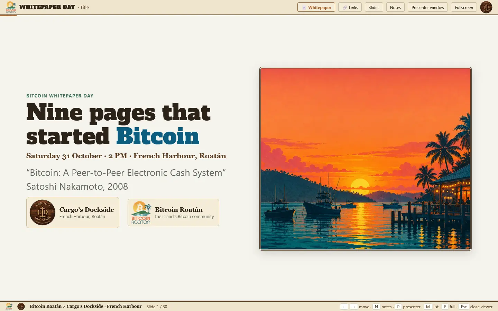

# Nine pages that started Bitcoin 🟠

An interactive journey through Satoshi Nakamoto’s Bitcoin whitepaper, made for Whitepaper Day in Roatán.

[▶ Open the presentation](https://itstomekk.github.io/bitcoin-whitepaper-slides/) · [Speaker notes](speaker-notes.md) · [Development](DEVELOPMENT.md)

> The Pages link is planned: this repository is currently local only and has not been published.

## 🔍 Explore

Follow the story from the problem of digital copies to signatures, proof-of-work, the network and confirmations. The 30 slides include interactive demonstrations; on slide 19, follow Alice’s payment through the network. The deck is a teaching model, not a real wallet or a financial tool.

## 🎤 How to present

Open `docs/index.html` and choose **Open the deck**, or open `docs/deck.html` directly in a browser. Use **← / →** to move between slides; **N** toggles speaker notes and **P** opens the presenter window. Allow popups when prompted. The presenter window shows notes and navigation alongside a timer. Additional notes are in [speaker-notes.md](speaker-notes.md). The deck itself works offline; external links require internet access.

## 🤝 Help and reuse

Feedback and improvements are welcome. Read [DEVELOPMENT.md](DEVELOPMENT.md) and [UPDATING.md](UPDATING.md) before contributing.

The presentation code is licensed under the [MIT License](LICENSE). The Bitcoin whitepaper text is MIT licensed by its author, as stated by [bitcoin.org](https://bitcoin.org/bitcoin.pdf). Event branding and organization logos are not licensed for reuse. Illustrations are project assets; the code license does not grant rights to branding or logos.
